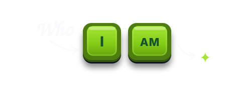
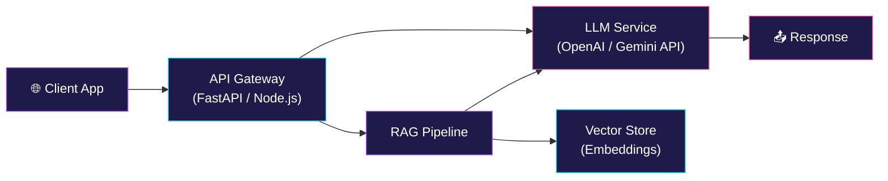

<!-- Hero Banner -->

---

## 🧠 About Me

Hey there! I'm **Vanshika Soni** — a second-year B.Tech CSE (AI/ML) student at **Newton School of Technology (ADYPU)** with a strong focus on building intelligent developer tooling, retrieval-augmented generation (RAG) pipelines, and autonomous AI agents.

My daily work balances three key fronts:
- 🚀 **Open Source & Tooling**: Actively contributing to [**foss42/apidash**](https://github.com/foss42/apidash) (a modern API client built with Dart & Flutter) with my sights firmly locked on **Google Summer of Code (GSoC) 2027**.
- 🤖 **AI Agency & Automation**: Co-founder of an AI automation agency where we architect production n8n workflows, LLM API integrations, 3D product configurators, and AR try-on experiences for real-world clients.
- 🎓 **Campus Leadership**: Serving as a **Google Gemini Campus Ambassador**, organizing workshops, demonstrations, and developer meetups to foster hands-on AI innovation.

<table>
<tr><td align="center">🎓 <b>Education</b></td><td>B.Tech CSE (AI/ML) · <b>Newton School of Technology (ADYPU)</b> · 2nd Year</td></tr>
<tr><td align="center">🎯 <b>North Star</b></td><td><b>GSoC 2027 Aspirant</b> · Open-source contributor building high-leverage developer tools</td></tr>
<tr><td align="center">⚡ <b>Active Sprints</b></td><td>Contributing to <a href="https://github.com/foss42/apidash"><b>foss42/apidash</b></a> · Cracking Dart &amp; Flutter</td></tr>
<tr><td align="center">🤖 <b>Agency &amp; Roles</b></td><td>Co-founder of AI automation agency (n8n workflows, 3D configurators, AR try-on) · <b>Google Gemini Campus Ambassador</b></td></tr>
<tr><td align="center">📍 <b>Location</b></td><td>TODO</td></tr>
</table>

## ⚡ Currently

- 🔨 **Building:** AI automation workflows with n8n + LLM APIs; 3D/AR web experiences for clients
- 📚 **Learning:** Dart & Flutter · Exploring deeper system design patterns
- 🤝 **Contributing to:** [foss42/apidash](https://github.com/foss42/apidash) — a FOSS REST API client (Dart/Flutter codebase)
- 💡 **Open to:** GSoC 2027 mentorship · open-source collaboration · developer tooling projects

## 🛠️ Tech Arsenal

 

**Languages**

**Backend**

**Frontend**

**AI & LLMs**

**Automation**

**3D & AR**

**Tools**

## 🤖 AI & System Design

My AI work centres on connecting LLMs to real data sources through retrieval-augmented generation (RAG) pipelines, exposing capabilities via clean REST APIs, and orchestrating multi-step AI agents. I use the Model Context Protocol (MCP) to give language models structured access to tools and context, and wire everything together with n8n automation workflows. The architecture below reflects the pattern I return to most often: a gateway layer that handles routing and auth, a RAG layer that grounds responses in a vector store, and a downstream LLM that does the generation.

*↑ Typical architecture I work with — client facing API, FastAPI/Node.js gateway, LLM + RAG layer with vector-store retrieval.*

## 🚀 Featured Projects

<table>
<thead><tr><th>Project</th><th>What it solves</th><th>Tech</th><th>Link</th></tr></thead>
<tbody>
<tr>
<td>🧭 <b>OpenSource Navigator</b></td>
<td>AI-powered tool that helps maintainers verify PRs and guides first-time contributors through open-source workflows</td>
<td>  </td>
<td>TODO (repo not yet public)</td>
</tr>
<tr>
<td>🏦 <b>Headwigs FinTech</b></td>
<td>UPI fraud prevention system using ML-based anomaly detection on transaction patterns</td>
<td></td>
<td><a href="https://github.com/vanshikasoni22/Headwigs-FinTech-UPI-Fraud-Prevention-System">View →</a></td>
</tr>
<tr>
<td>🎮 <b>3D/AR Client Work</b></td>
<td>3D product configurators and AR try-on experiences for e-commerce clients; AI digital-human demo</td>
<td>  </td>
<td>TODO (private client work)</td>
</tr>
</tbody>
</table>

## 💼 Experience & Roles

- 🤖 **AI Automation Agency — Co-Founder** · Building client automation systems using n8n, LLM APIs, and custom integrations. Delivered 3D configurators, AR try-on tools, and an AI digital-human demo for clients.
- 🎓 **Google Gemini Campus Ambassador** · Representing Google's Gemini AI ecosystem; running campus workshops and product demos.
- 🌍 **Open-Source Contributor** · Active across GSSoC, SHAP eSoC, Hacktoberfest, and currently contributing to API Dash (foss42/apidash).

## 🌱 Open Source Journey

| Program | Role | Status |
|---|---|---|
| 🏆 GSSoC (GirlScript Summer of Code) | Contributor | ✅ Participated |
| 🌟 SHAP eSoC | Contributor | ✅ Participated |
| 🎃 Hacktoberfest Hack Day | Contributor | ✅ Participated |
| 🔧 API Dash (foss42/apidash) | Contributor (Dart/Flutter) | 🔄 In Progress |

### Merged PRs

| # | Repository | PR Title | Status |
|---|---|---|---|
| TODO | foss42/apidash | TODO | 🔄 In Progress |

> *This table is updated as contributions are merged. No fabricated stats.*

### 🐍 Contribution Activity Snake

<picture>
  <source media="(prefers-color-scheme: dark)" srcset="https://raw.githubusercontent.com/vanshikasoni22/vanshikasoni22/output/github-contribution-grid-snake-dark.svg">
  <source media="(prefers-color-scheme: light)" srcset="https://raw.githubusercontent.com/vanshikasoni22/vanshikasoni22/output/github-contribution-grid-snake.svg">
  
</picture>

## 📬 Connect

  

